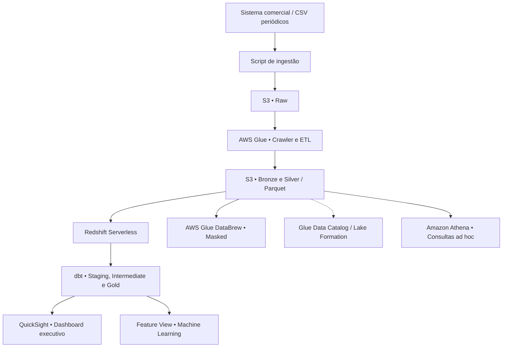
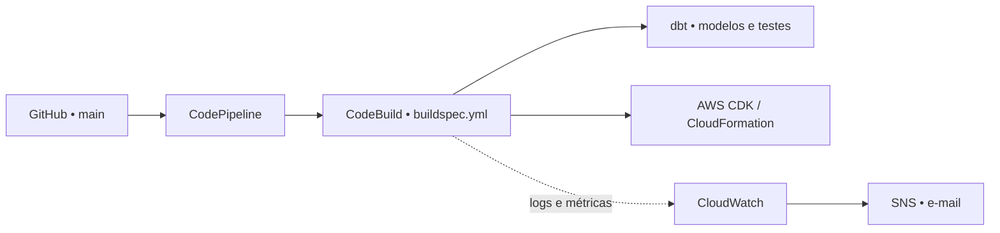

# TechNova Varejo | Enterprise DataOps

**Engenharia de Dados, Governança, Analytics e CI/CD na AWS**  
Projeto acadêmico desenvolvido a partir de um cenário de modernização de dados no varejo.

**[📚 Documentação interativa do dbt](https://fobious.github.io/technova-enterprise-dataops/)**  

Organização das branches:

- main: código-fonte principal, infraestrutura AWS, pipelines, transformações dbt e consultas SQL.
- gh-pages: publicação da documentação técnica no GitHub Pages.
---

## 1. Contexto do negócio

A **TechNova Varejo** representa uma empresa de comércio varejista que precisa acompanhar suas vendas com dados confiáveis. No cenário inicial, o sistema comercial exportava periodicamente arquivos CSV para uma pasta local. A consolidação desses arquivos e a atualização dos relatórios dependiam de atividades manuais, dificultando a rastreabilidade, a padronização e a análise histórica.

O objetivo do projeto foi transformar esse processo em uma arquitetura de dados na AWS, com ingestão automatizada de arquivos, tratamento em camadas, controles de qualidade, governança, visualização de indicadores e implantação automatizada do código.

> **Escopo:** a solução implementada utiliza ingestão de arquivos em lote (*batch*). O monitoramento de vendas em tempo real com streaming foi estudado como possibilidade de evolução, não como funcionalidade já implantada.

## 2. Dados utilizados

A base do projeto é composta por exportações históricas de vendas em **CSV**, com dados de pedidos, clientes, produtos, valores, formas de pagamento e informações comerciais.

| Característica | Base utilizada no projeto |
|---|---|
| Origem | Arquivos CSV exportados pelo sistema comercial do cenário TechNova |
| Quantidade de arquivos históricos | 34 |
| Registros de pedidos após a carga e validação | 99.469 |
| Período coberto | 01/01/2024 a 19/10/2026 |
| Principais informações | Pedido, cliente, produto, data da compra, quantidade, valores, desconto, pagamento, status, canal, cidade e região |
| Dados pessoais tratados | Nome, e-mail e CPF, sujeitos a mascaramento e controle de acesso |

Esses números representam o conjunto histórico utilizado e validado na implementação acadêmica; não indicam uma integração em tempo real com um sistema de vendas em produção.

## 3. Como foi feita a ingestão e o processamento

A ingestão é **baseada em arquivos, em lote (batch)**: um mecanismo de ingestão identifica arquivos de vendas e os envia ao Amazon S3 com um usuário IAM dedicado e permissões limitadas ao necessário. A partir da camada Raw, o AWS Glue executa o processamento e organiza os dados para o uso analítico.

| Etapa | Serviço | O que foi implementado |
|---|---|---|
| Entrada / Raw | Amazon S3 | Recebimento e preservação dos CSV originais, com versionamento e bloqueio de acesso público |
| Catalogação | AWS Glue Crawler / Data Catalog | Identificação e registro das estruturas de dados |
| Bronze | AWS Glue + S3 | Padronização técnica, tipagem e rastreabilidade da origem e data de ingestão |
| Silver | AWS Glue + S3 | Limpeza, validações, padronização e deduplicação |
| Armazenamento otimizado | S3 | Dados tratados em **Apache Parquet**, com compressão **Snappy** e particionamento por data |
| Data warehouse | Amazon Redshift Serverless | Carga dos dados tratados e disponibilização para modelagem analítica |
| Gold | dbt + Redshift | Modelos dimensionais e testes de qualidade para consumo por BI e análises |

A carga histórica validada processou **99.469 registros**, com conferência de integridade entre as etapas. O uso de Parquet e particionamento ajuda a reduzir o volume lido nas consultas analíticas.

### Fluxo principal de dados



## 4. O que o dashboard entrega ao negócio

O painel executivo foi desenvolvido no **Amazon QuickSight**, utilizando dados analíticos da camada Gold no Redshift e **SPICE** para acelerar a navegação.

Na versão apresentada no trabalho, o dashboard possui os seguintes indicadores:

| KPI | Resultado apresentado |
|---|---:|
| Receita total | R$ 92.624.761,25 |
| Pedidos | 99.469 |
| Ticket médio | R$ 931,19 |
| Quantidade vendida | 125.595 |

Além dos indicadores gerais, o painel permite analisar **receita por canal de venda, categoria de produto e região**, a **distribuição dos status dos pedidos** e a **evolução mensal da receita**. Os filtros incluem canal, status, região, categoria e período.

**Finalidade:** substituir consolidações manuais por uma visão gerencial organizada, ajudando a identificar tendências comerciais, diferenças entre canais e regiões e o desempenho das vendas ao longo do tempo.

## 5. Governança, segurança e LGPD

A governança foi implementada em diferentes pontos da arquitetura:

- **IAM:** usuários e funções com permissões específicas para ingestão e processamento, além de MFA no usuário utilizado para administrar o ambiente.
- **Amazon S3:** versionamento dos dados originais e bloqueio de acesso público.
- **AWS Glue DataBrew:** criação de uma camada **Masked** a partir da Silver, com mascaramento de nome, e-mail e CPF. A validação preservou a quantidade de 99.469 registros.
- **AWS Lake Formation:** registro da localização governada da camada Silver, integração ao Glue Data Catalog e configuração de permissões em nível de coluna. O usuário operacional recebeu permissão de leitura na tabela `silver_vendas`, **com a coluna `cpf` excluída**.
- **AWS Secrets Manager:** armazenamento de credenciais utilizadas na integração com Redshift.
- **dbt:** testes de qualidade para apoiar a confiabilidade das transformações.

**Por que Lake Formation aparece aqui mesmo sem arquivos próprios?** Parte da governança foi configurada diretamente nos serviços AWS e demonstrada nas evidências do relatório. Nem toda configuração feita no console ou pela CLI precisa corresponder a um script versionado; o README descreve o que foi implementado, sem afirmar que existe uma automação de governança que não foi entregue.

## 6. Modelagem e qualidade com dbt

No Amazon Redshift Serverless, o dbt organiza os dados nas camadas de *staging*, transformação intermediária e *marts*:

- `stg_vendas`
- `ref_vendas_enriquecidas`
- `dim_cliente`
- `dim_produto`
- `dim_pagamento`
- `dim_tempo`
- `fato_vendas`

**Resultado validado em 02/11/2026:** **7 modelos** executados e **29 testes** aprovados, sem erros ou avisos na execução integrada (`PASS=36`, `ERROR=0`). Os testes incluem campos obrigatórios, unicidade, valores permitidos, relacionamentos e duas regras SQL personalizadas sobre cadastro de clientes e valores de pedidos.

### Documentação navegável

A documentação foi gerada com `dbt docs generate` e está hospedada no GitHub Pages:

**➡️ [Abrir dbt Docs — modelos, colunas, testes e linhagem](https://fobious.github.io/technova-enterprise-dataops/)**

Os arquivos publicados ficam na branch **[`gh-pages`](https://github.com/Fobious/technova-enterprise-dataops/tree/gh-pages/docs)**, separada da branch `main` usada pelo pipeline da AWS. Assim, a ausência de `docs/` na raiz da `main` é intencional.

## 7. Consumo analítico e preparação para ML

- **Amazon Athena:** consultas SQL *ad hoc* sobre dados do S3, com Workgroup dedicado, controle de dados processados por consulta e resultados armazenados em bucket S3 próprio para auditoria.
- **Amazon QuickSight:** dashboard publicado com filtros, diferentes visualizações e dataset importado no SPICE.
- **Feature View no Redshift:** `technova.vw_ml_customer_features`, que organiza atributos por cliente (como frequência, valor, recência, descontos e comportamento de compra) para futuro uso analítico ou em Machine Learning.

## 8. CI/CD e infraestrutura como código

O repositório usa GitHub como fonte de código. Alterações na branch `main` acionam o **AWS CodePipeline**, que coordena a execução do **AWS CodeBuild**. O CodeBuild segue o `buildspec.yml` para preparar dependências, validar a conexão com o Redshift, executar os modelos e testes dbt e realizar o deploy do **AWS CDK** por meio do CloudFormation.



A execução integrada foi concluída com sucesso, inclusive após a reorganização do repositório. O monitoramento utiliza logs do CloudWatch, um alarme de falhas do projeto CodeBuild com ação SNS e uma regra EventBridge para eventos de falha do CodePipeline. O envio manual pelo SNS também foi validado.

## 9. Provas de conceito e evolução da arquitetura

O projeto também incluiu uma **PoC com Apache Iceberg** no Amazon Athena, com criação de tabela no S3 e execução de uma instrução `UPDATE`, além do uso de Parquet com Snappy no processamento dos dados.

Como evolução futura, foram avaliadas uma arquitetura híbrida orientada a eventos para vendas quase em tempo real, a integração da governança ao conceito de **Data Fabric** e tendências do **Modern Data Stack**: streaming, arquitetura Lakehouse e observabilidade de dados apoiada por IA. Essas evoluções não devem ser confundidas com os componentes já implantados.

## 10. Estrutura do repositório

```text
technova-enterprise-dataops/
├── athena/queries/             # Consultas Athena versionadas
├── dbt/technova_dbt/          # Modelos, testes e configuração dbt
├── glue/                     # Scripts de processamento AWS Glue
├── governance/lakeformation/ # Diretório de governança; configurações AWS descritas neste README
├── infrastructure/           # Definições em Python do AWS CDK
├── redshift/sql/             # Consultas SQL para Redshift
├── .gitignore
├── buildspec.yml             # Etapas do AWS CodeBuild
└── README.md

# Publicação separada: branch gh-pages, diretório docs/
```

## 11. Evidências e observações

As evidências acadêmicas do trabalho incluem capturas das configurações AWS, processamento Glue, testes dbt, publicação da documentação, dashboard QuickSight, PoC Iceberg, automação CI/CD e monitoramento.

Este repositório reúne código e documentação do projeto, mas **não é um instalador completo de toda a conta AWS**: algumas configurações de serviços gerenciados foram realizadas diretamente no ambiente e registradas no relatório. Por segurança, credenciais, tokens e dados pessoais não devem ser publicados aqui.

---

**TechNova Varejo — Projeto acadêmico de Engenharia de Dados e DataOps na AWS.**
