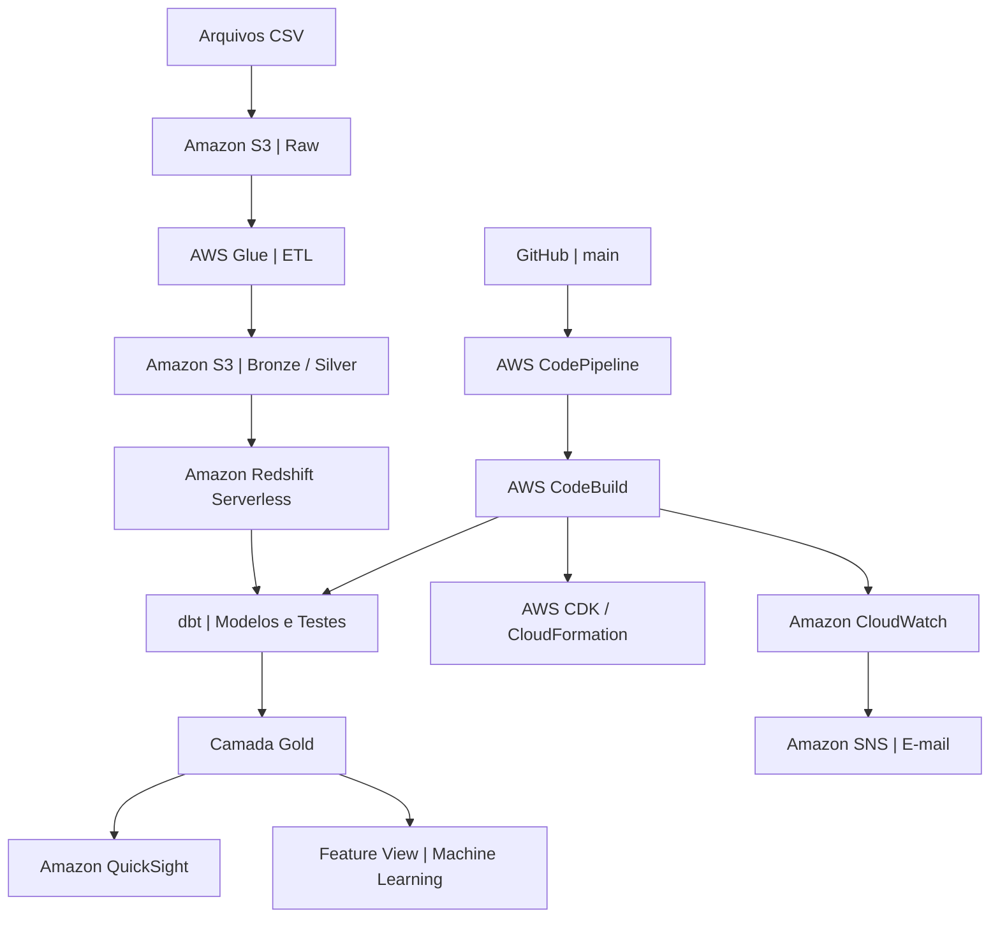

# TechNova Varejo | Enterprise DataOps

### Engenharia de Dados, Analytics, MLOps e CI/CD na AWS

Projeto acadêmico de implementação de uma arquitetura moderna de dados na AWS, integrando ingestão, processamento, transformação, qualidade, análise e automação de infraestrutura.

---

## 1. Visão geral

O projeto TechNova Varejo demonstra a construção de um ambiente de dados em nuvem, utilizando serviços gerenciados da AWS e práticas de engenharia de dados.

A solução contempla:

- Arquitetura de dados em camadas Bronze, Silver e Gold.
- Processamento e catalogação com AWS Glue.
- Armazenamento no Amazon S3.
- Transformações analíticas no Redshift Serverless.
- Modelagem dimensional e testes de qualidade com dbt.
- Dashboards gerenciais no Amazon QuickSight.
- Preparação de dados para Machine Learning.
- Integração e implantação contínua (CI/CD).
- Monitoramento e notificações de falhas.

## 2. Arquitetura da solução



## 3. Tecnologias utilizadas

| Tecnologia | Responsabilidade |
|---|---|
| Amazon S3 | Armazenamento dos dados |
| AWS Glue | Processamento ETL e catalogação |
| Amazon Athena | Consultas SQL sobre dados no S3 |
| Amazon Redshift Serverless | Data warehouse analítico |
| dbt | Transformação, modelagem e testes |
| Amazon QuickSight | Visualização de indicadores |
| AWS CodePipeline | Orquestração do CI/CD |
| AWS CodeBuild | Execução automatizada |
| AWS CDK | Infraestrutura como código |
| AWS CloudFormation | Implantação da infraestrutura |
| Amazon CloudWatch | Logs e alarmes |
| Amazon SNS | Notificações por e-mail |
| Amazon EventBridge | Roteamento de eventos |

## 4. Transformação e qualidade dos dados

O dbt é utilizado para construir modelos analíticos no Redshift, organizados nas camadas de staging, intermediate e marts.

### Modelos implementados

- `stg_vendas`
- `ref_vendas_enriquecidas`
- `dim_cliente`
- `dim_produto`
- `dim_pagamento`
- `dim_tempo`
- `fato_vendas`

### Resultado da execução automatizada

**Execução validada em 02/11/2026.**

| Indicador | Resultado |
|---|---:|
| Modelos dbt | 7 |
| Testes de qualidade | 29 |
| Execuções aprovadas | 36 |
| Erros | 0 |
| Avisos | 0 |

```text
Completed successfully
PASS=36 WARN=0 ERROR=0 SKIP=0
TOTAL=36
```

## 5. Automação CI/CD

A integração contínua foi implementada utilizando GitHub, AWS CodePipeline e AWS CodeBuild.

O fluxo é iniciado automaticamente por alterações na branch `main`.

O CodeBuild utiliza o arquivo `buildspec.yml` para executar:

1. Instalação das dependências.
2. Configuração e validação da conexão com o Redshift.
3. Construção dos modelos e execução dos testes dbt.
4. Deploy da infraestrutura utilizando AWS CDK.
5. Limpeza da regra temporária de acesso ao Redshift.

O AWS CDK define os recursos de CI/CD em Python, enquanto o CloudFormation realiza sua implantação.

**Resultado:** a primeira execução integrada foi concluída com sucesso, incluindo os modelos dbt, testes e atualização da infraestrutura.

## 6. Monitoramento

O projeto utiliza Amazon CloudWatch e Amazon SNS para monitorar falhas.

O alarme `TechNova-CodeBuild-FailedBuilds` acompanha a métrica `FailedBuilds` do CodeBuild, com limite de uma ou mais falhas em cinco minutos.

Quando o alarme é acionado, o SNS está configurado para enviar notificações por e-mail.

Também foi configurada uma regra EventBridge para identificar eventos de falha do CodePipeline.

## 7. Analytics e Machine Learning

O Amazon QuickSight foi utilizado para publicação de um dashboard gerencial baseado nos dados analíticos.

Para preparação de dados para Machine Learning, foi criada uma Feature View no Redshift:

`technova.vw_ml_customer_features`

Essa estrutura disponibiliza atributos preparados para utilização por modelos analíticos e preditivos.

## 8. Estrutura do repositório

```text
technova-enterprise-dataops/
├── athena/
│   └── queries/
├── dbt/
│   └── technova_dbt/
├── glue/
├── governance/
│   └── lakeformation/
├── infrastructure/
│   ├── app.py
│   ├── cdk.json
│   └── infrastructure/
│       └── infrastructure_stack.py
├── redshift/
│   └── sql/
├── .gitignore
├── buildspec.yml
└── README.md
```

## 9. Segurança e configuração

As credenciais de conexão com o Redshift são armazenadas no AWS Secrets Manager, sem exposição de senhas no código-fonte.

O projeto utiliza permissões IAM para controlar o acesso dos serviços e configuração temporária de rede para a execução do dbt.

A implantação pressupõe recursos AWS e permissões previamente configurados, conforme a arquitetura do projeto.

---

**TechNova Varejo — Projeto acadêmico de Engenharia de Dados e DataOps.**
